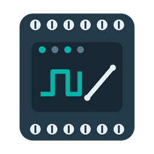

# Phoenix Contact CatanIO for Home Assistant



Control the inputs and outputs of the Phoenix Contact Catan building controller
from Home Assistant. The integration talks to the devices directly through the
[CatanIO API](https://github.com/PLCnext/CatanIO) (CoAP with Protocol Buffers)
and is meant for Home Assistant running as a container on the Catan C1.

> This is a community project. It is not made or supported by Phoenix Contact.

## Supported devices

| Device | Article number | Channels |
|---|---|---|
| CATAN C1 | 1886438 | UI 1-8, DOI 9-12, UOI 13-14, UV 1-8 |
| CATAN DOR6 UI8 | 1371364 | UI 1-8, DOR 1-6 |
| CATAN DOI8 UOI8 UI8 | 1818583 | UI 1-8, DOI 9-16, UOI 17-24, UV 1-8 |
| CATAN DALI MM4 DOI8 | 1371363 | DOI 1-8, UV 1-8 (DALI itself is not supported) |

Each device becomes its own device in Home Assistant. The entities of a channel
depend on the mode the channel is configured for on the device:

| Channel mode | Entities |
|---|---|
| Analog input (UI) | Sensor with the processed value. Diagnostic sensor with the raw sensor value |
| Digital input (UI, UOI, DOI) | Binary sensor. Sensors for switching cycles and on time |
| Counter (UI, UOI, DOI) | Sensor with the scaled counter value, sensor with the pulse count |
| Digital output (UOI, DOI, DOR, UV) | Switch. Sensors for switching cycles and on time |
| Analog output 0-10 V (UOI, UV) | Number. Diagnostic sensor with the actuator voltage |
| Every channel | Diagnostic sensors for the point status and the I/O error |

Every device also has sensors for the number of points in failure and
overridden, binary sensors for the controller and display connection and the
device button, and buttons to identify and restart the device.

The channel name and unit configured on the device are used for the entity
name and unit. Units such as `°C`, `V`, `mA`, `W`, `kWh`, `hPa` or `lx` also
set the matching device class, so a counter in `kWh` can be used in the energy
dashboard.

Entities of the virtual display data points (UV), diagnostic values, switching
cycles and on times are disabled by default. Enable them on the device page if
you need them.

## Requirements

- Home Assistant 2026.10 or newer. The Marketplace is part of Home Assistant
  2026.11.
- Home Assistant must reach the devices on UDP port 5683. On the Catan C1 run
  the container with `network_mode: host`, as in the
  [Home Assistant example](https://github.com/PLCnext/CatanIO/tree/main/examples_container/home_assistant)
  of the CatanIO project.

## Installation

1. In Home Assistant go to **Settings > Marketplace**.
2. Search for **Phoenix Contact CatanIO** and select **Download**.

Until the integration is listed in the catalog, add this repository as a
custom repository in the Marketplace first.

## Setup

1. Go to **Settings > Devices & services > Add integration** and select
   **Phoenix Contact CatanIO**.
2. The integration searches the local bus of the Catan C1. Select the device
   to set up, or enter an address manually.
3. All other devices that were found show up under **Discovered** right away.
   Select **Add** for each one you want to use.

The search runs again every 15 minutes. Extension modules added later are
offered automatically, and when a device gets a new address from the DHCP
server of the C1, the integration updates it.

### How the discovery works

The devices use link-local addresses, which the DHCP discovery of Home
Assistant ignores, and they do not announce themselves through zeroconf. The
integration therefore searches on its own: it asks the I/O of the C1 at
`169.254.253.1` for its identity and asks the C1 backend at `169.254.253.2`
(`PATCH /sys/discover`, read-only) for the extension modules on the local bus.
Because this search only runs once the integration is loaded, the first device
is added through **Add integration**. All further devices are proposed by Home
Assistant.

To change the address of a device, select **Reconfigure** on its entry.

## Data updates

The integration polls the system status and every enabled channel every 5
seconds, one CoAP request after the other per device. Switching an output or
setting a number updates the entity right away from the response of the
device.

When a channel is switched to another mode on the device, the integration
reloads the entry and replaces the entities of the channel.

## Examples

Switch a pump on when the outdoor temperature falls below 3 °C:

```yaml
automation:
  - alias: Frost protection
    triggers:
      - trigger: numeric_state
        entity_id: sensor.catan_c1_outdoor_temperature
        below: 3
    actions:
      - action: switch.turn_on
        target:
          entity_id: switch.catan_c1_pump
```

Set an analog output to 7.5 V:

```yaml
action: number.set_value
target:
  entity_id: number.catan_c1_uoi_13
data:
  value: 7.5
```

## Known limitations

- The channel configuration (mode, name, unit, limits) is read from the device
  and cannot be changed from Home Assistant. Use the display or the commissioning
  tool for that.
- Overrides, counter initialization and wiring tests of the API are not
  available as actions yet.
- Values are polled. The CatanIO documentation states that CoAP Observe has to
  be verified per resource and firmware, so push updates are not used yet.
  Short pulses on digital inputs between two polls are only visible in the
  switching cycle counter.
- The DALI interface of the CATAN DALI MM4 DOI8 is still a draft upstream and
  not supported.
- Values are only shown while the point status is OK or overridden. Outputs
  stay controllable during a hardware failure.

## Troubleshooting

- **No devices are found:** Make sure Home Assistant runs with host networking
  on the Catan C1 and that UDP port 5683 is not blocked. Add the device
  manually with its address to see the exact error.
- **A device is unavailable after a restart of the C1:** The DHCP server may
  have assigned another address. The next search updates it, or select
  **Reconfigure** and enter the new address.
- **Entities are unavailable:** Check the diagnostic status and error sensors
  of the channel. A disconnected sensor reports `Sensor not connected`.

Enable debug logs and download the diagnostics of the entry when you report an
issue:

```yaml
logger:
  logs:
    custom_components.catanio: debug
    aiocoap: info
```

## Removal

1. Go to **Settings > Devices & services**, open **Phoenix Contact CatanIO**
   and delete each entry.
2. Remove the integration in **Settings > Marketplace**.

## Development

The CoAP client in `custom_components/catanio/api/` has no Home Assistant
dependencies. It loads the protobuf schemas from a descriptor set compiled from
the upstream `.proto` files in [`proto/`](proto/), see
[`proto/README.md`](proto/README.md).

```bash
python -m venv .venv && . .venv/bin/activate
pip install -r requirements_test.txt
pytest --cov
ruff check . && ruff format --check . && mypy
```

The client tests run against a fake CatanIO device that serves the protobuf
messages over CoAP on localhost.

## Credits

The protobuf schemas in `proto/` are copyright Phoenix Contact GmbH & Co KG and
licensed under the MIT license.
